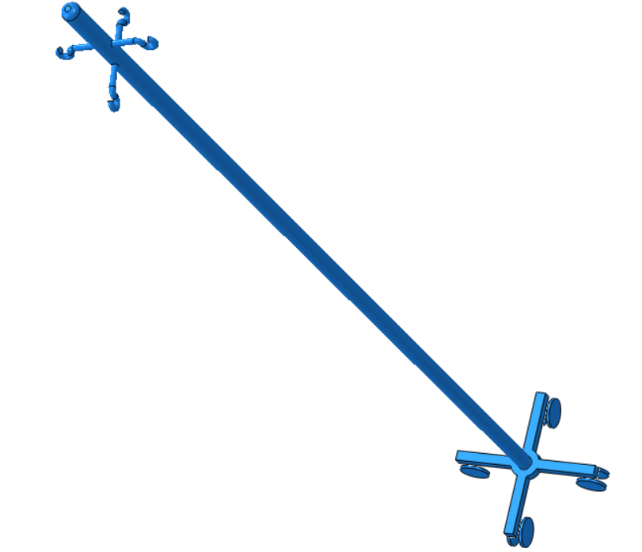
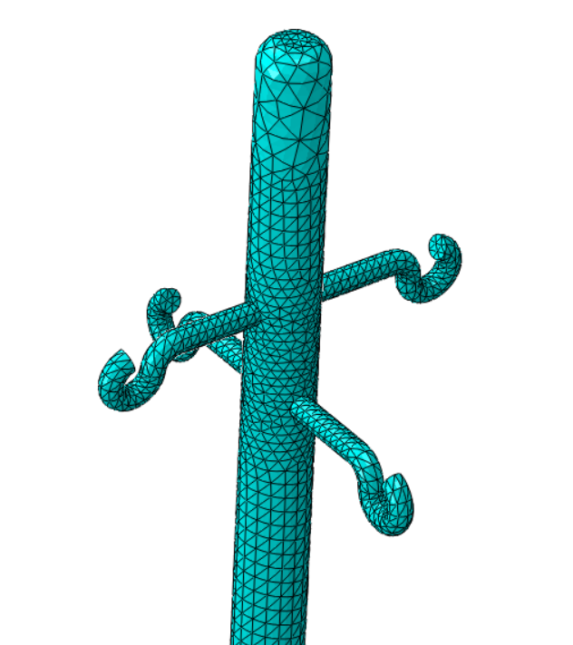
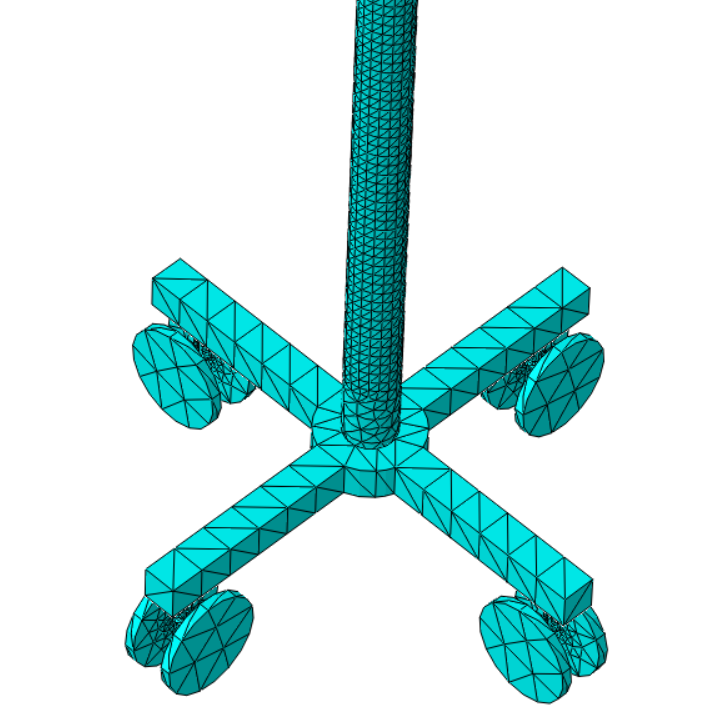
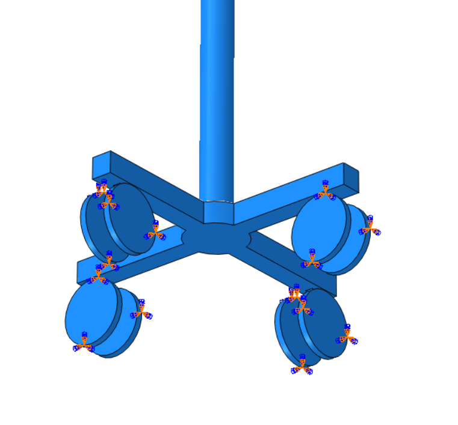
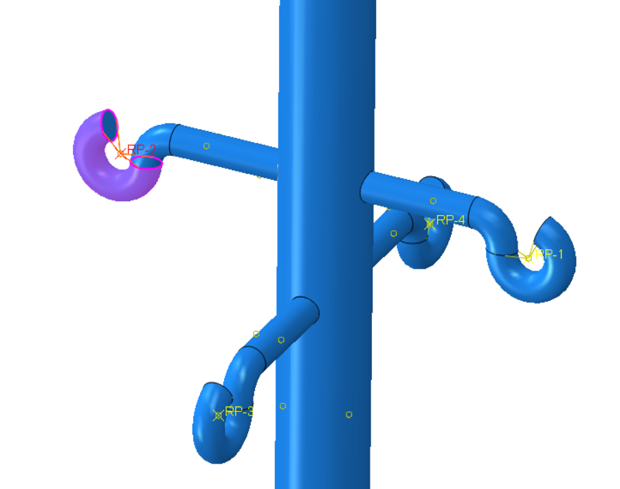
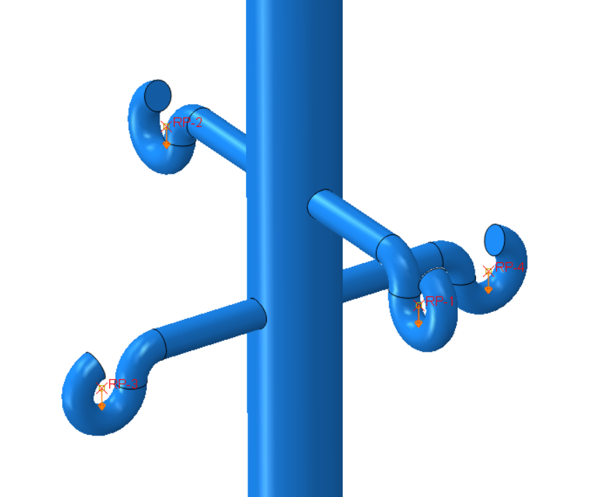
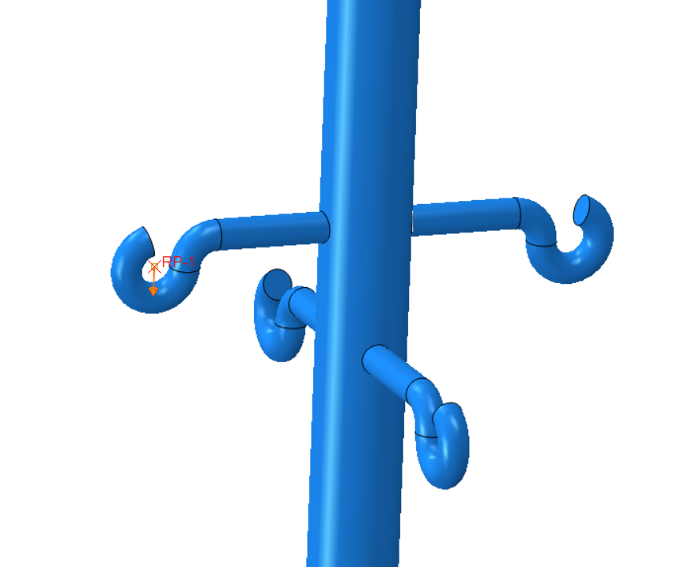
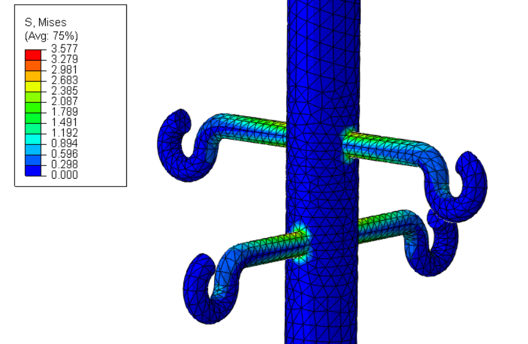
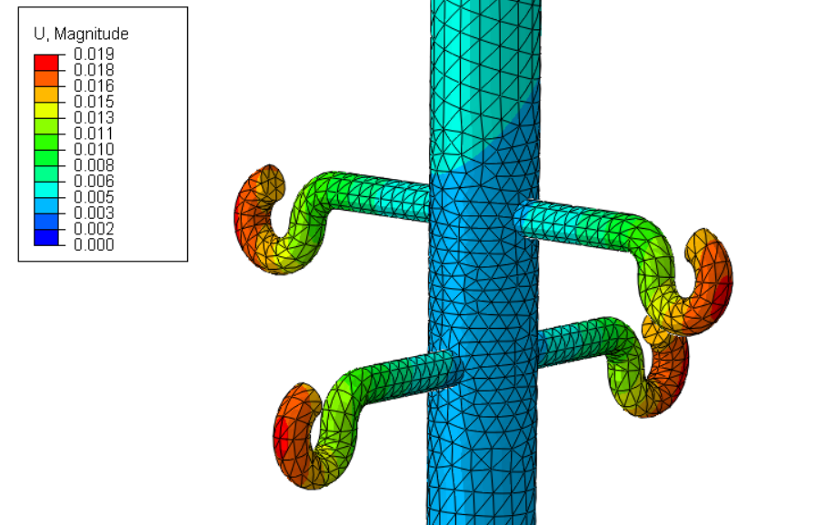
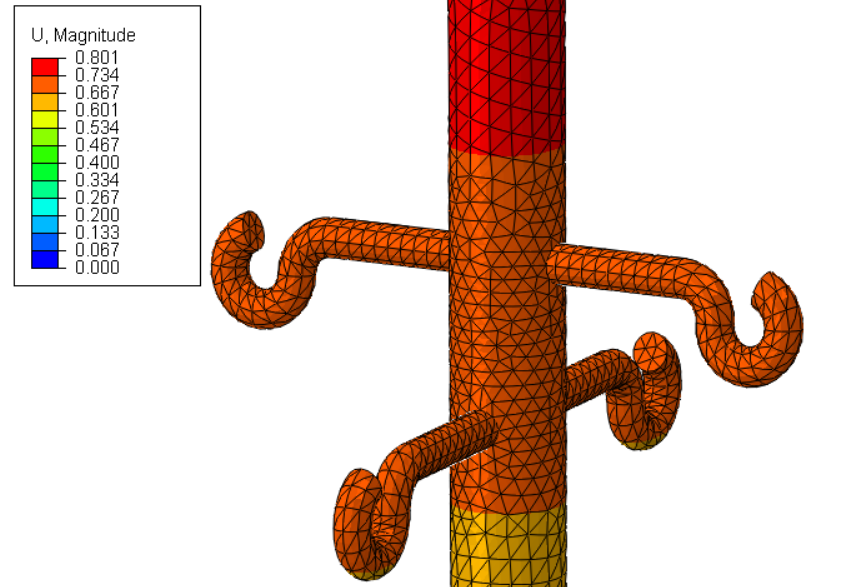

# abaqus-medical-iv-stand
Finite element analysis of a medical IV stand under symmetric and asymmetric hook loading using Abaqus/CAE.
# Medical IV Stand: FEA of Symmetric vs. Single-Hook Loading

Linear static finite element analysis of a wheeled medical IV stand in Abaqus/CAE. The same stand is loaded in two ways: **20 N spread evenly over four hooks**, and **15 N hanging on a single hook**. The goal is to see how much the position of the load matters compared to its size.

## Results at a glance

| | Symmetric (4 hooks x 5 N) | Single hook (1 hook x 15 N) | Ratio |
| :--- | ---: | ---: | ---: |
| Total load | 20 N | 15 N | 0.75x |
| Max von Mises stress | 3.577 MPa | 9.121 MPa | about 2.55x |
| Max displacement | 0.019 mm | 0.801 mm | about 42x |

Even though the single-hook case carries 25% less total load, the stand deflects about 42 times more, and the peak stress is about 2.5 times higher. In both cases the peak stress is at the root of a hook, where the hook enters the pole.

## About the model

- **Geometry:** the stand was designed in PTC Creo Parametric by a colleague and imported into Abaqus/CAE. I did not model the geometry.
- **My part:** I rebuilt the whole Abaqus model from the imported geometry: material, mesh, connections between parts, supports, loads, both load cases and the post-processing.
- **Tool:** Abaqus/CAE (Standard solver).
- **Units:** mm, N, MPa.

## Model setup

### Material
All parts use one isotropic, linear elastic aluminium-silicon (AlSi) alloy.

| Property | Value |
| :--- | ---: |
| Young's modulus (E) | 70,000 MPa |
| Poisson's ratio | 0.33 |

### Mesh
3D quadratic tetrahedral elements (C3D10). Results come from a single mesh; no mesh convergence study was done.

### Connections between parts
Nine named **Tie** constraints join the separate parts of the assembly, so they behave as one connected structure.

### Supports
The four wheels are fixed in all directions (ENCASTRE: no translation, no rotation). This means the stand cannot roll or tip in the model, and the pole bends relative to the wheels.

### How the hooks are loaded
A force applied to a single node would create an artificial stress spike. Instead, each loaded hook has a reference point connected to a ring of nodes on the circular cross-section of the hook through a **continuum distributing coupling** (uniform weighting). The force goes into the reference point and is spread over the whole ring of nodes.

### Load cases
Loads act vertically downward (the +Z axis of the model points down). Both are single static steps.

1. **Symmetric:** 5 N on each of the four hooks, 20 N in total.
2. **Single hook:** 15 N on one hook, 15 N in total.

## Results

### Load case 1: symmetric (4 x 5 N)
- Max von Mises stress: **3.577 MPa**, at the roots of the hooks.
- Max displacement: **0.019 mm**, at the tips of the hooks (the hooks themselves flex slightly).

### Load case 2: single hook (1 x 15 N)
- Max von Mises stress: **9.121 MPa**, at the root of the loaded hook, where it enters the pole.
- Max displacement: **0.801 mm**, at the top of the pole. The whole stand leans sideways.

## Discussion

- **Symmetric loading:** the four hooks are arranged in opposite pairs, so their moments cancel out on the pole. The pole is mostly pressed along its axis and hardly bends. The only visible movement is the hooks flexing.
- **Single-hook loading:** nothing balances the load, so it bends the pole sideways. The displacement grows along the pole and is largest at the top, which is why the deflection ratio (about 42x) is much bigger than the stress ratio (about 2.5x).
- **Stress at the hook root:** the loaded hook carries 3 times the force of one hook in the symmetric case (15 N vs 5 N), and the peak stress rises by about 2.5 times. This is consistent with the peak stress being driven mainly by how much that one hook is bent.
- **Margin:** the stresses (a few MPa) are small compared with typical yield strengths of aluminium alloys, so the stand stays elastic in both cases. I did not look up a yield value for this specific alloy.

## Limitations

- The material is linear elastic, so the model cannot show yielding or any other non-elastic behaviour.
- Results are from one mesh, with no convergence study.
- The results were not compared with physical measurements.
- The loads are small, fixed values (5 N and 15 N). They are for comparing the two load cases, not a certified design load.

## Files

- `models/Symmetric-4-hook-load.inp`: input file for load case 1
- `models/Asymmetric-1-hook-load.inp`: input file for load case 2
